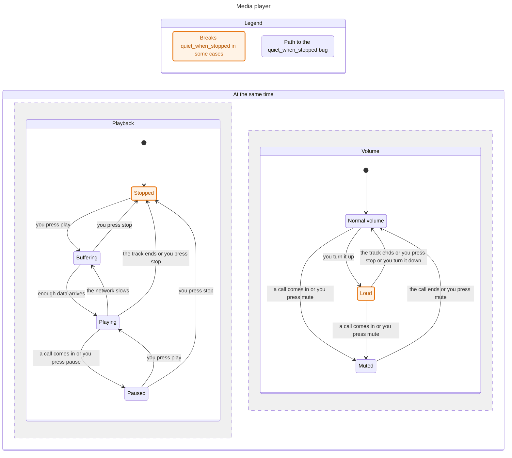
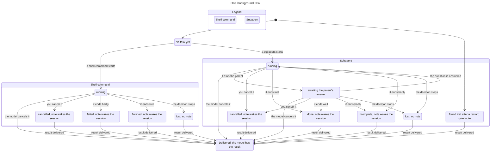

# bend-statechart: see a Bend state machine whole, and check it

An agent skill for Bend 2 state machines. It takes a core written as a state machine
(`core.bend` with `start` and `step`, plus its `LAWS.bend`), visits every state reachable over
a bounded set of events, checks every law on every state and step, and draws the graph as a
Mermaid statechart in the words of the person who has to approve it. When a rule breaks, the
report gives the shortest path of events from the start to the break.

It is the companion of [bend-ldd](https://github.com/nohzafk/bend-ldd), the law-driven
development skill. bend-ldd proves each law for every input; this skill shows the human the
whole state graph first, so the decisions behind the laws are reviewed on a picture rather
than on law text.

## Where it comes from

The drawing is the `statechart` skill of
[pstack](https://github.com/cursor/plugins/tree/main/pstack/skills/statechart), vendored from
cursor/plugins at commit `2776ddd`. pstack checks a TLA+ model with TLC; this skill replaces
only the part that talks to TLC.

Vendored from pstack, unchanged:

- `scripts/ir.ts`, `scripts/pipeline.ts`, `scripts/statechart` (the runtime launcher)
- `scripts/passes/`: `label.ts`, `lift.ts`, `loop-check.ts`, `reach.ts`, `region-check.ts`, `regions.ts`
- `scripts/backends/`: `mermaid.ts`, `plain-text.ts`
- `scripts/frontends/view.ts`: the view contract
- `references/render.md`: rendering with Pele
- `scripts/test/MediaPlayer.mmd`: pstack's chart of its MediaPlayer example, from TLC

Vendored and changed:

- `scripts/backends/report.ts`: four sentences say "the search" and "a law" where pstack says
  TLC and its constraints. The sentences about TLC features that a Bend core has no use for
  (VIEW, SYMMETRY, CONSTRAINT, PROPERTY) are left as they are and never print.
- `scripts/test/pipeline.test.ts`: one expected line follows that change.

Written for Bend:

- `scripts/frontends/bend.ts`: the search. It visits the states, checks the invariants and laws,
  and builds the same `CheckResult` that pstack's TLC frontend builds.
- `scripts/run.ts`: compiles the unit with `bend-emit` and loads it.
- `scripts/statechart.ts`: the command.
- `scripts/test/bend.test.ts` and `examples/`.

The model is where this differs from pstack. A TLA+ model is a second description of the
system, and the code is written by hand to match it. In Bend the model is the core itself: the
definitions this skill explores are the ones `bend-emit` compiles for the host and the ones
`PROOF.bend` proves.

## Install

```sh
npx skills add nohzafk/bend-statechart
```

Install bend-ldd as well: this skill follows its language rules and its workflow, and sends
the agent to it before any `.bend` file is written.

## What you see

The agent runs the check and hands you a report: counts, the statechart, and for each broken
rule the shortest path of events to the break. You read the picture; you never run the script
yourself.

Below is pstack's media player written as a Bend core, `examples/player`. Playback and volume
change on their own, so the view draws them as two regions. The rule "when nothing plays, the
volume is never loud" breaks: turn the volume up while stopped. Apart from the rule's name and
the title, the chart is byte for byte the one pstack draws for the same machine from TLC.



Rendered with Pele and `references/render.md`, the same chart follows the viewer's light or
dark mode, with the group colors and the marks of the Legend.

A chart of a real core, one background task of a coding agent's session (`examples/tasks`):



## What it checks

On every reachable state and every step out of it:

- each invariant (a predicate of one state) and each law (a predicate of one step) that the
  model module maps to the reference predicates of `LAWS.bend`;
- **NoDeadlock**: a state that no event leaves must be one that the model calls terminal.

The search is bounded by the events the model generates, so a pass says nothing about every
input. The proofs in `PROOF.bend`, written with bend-ldd, do.

## What is in it

- `SKILL.md`: how to write the model and the view, read the report, and hand off.
- `scripts/statechart`: the command; the rest of `scripts/` is listed above.
- `examples/`: the media player, a session lifecycle, and a background task.

Run the tests with `node --test scripts/test/*.test.ts` (Node 22.18 or later).

## License

MIT. See `LICENSE`, which also carries pstack's notice.
